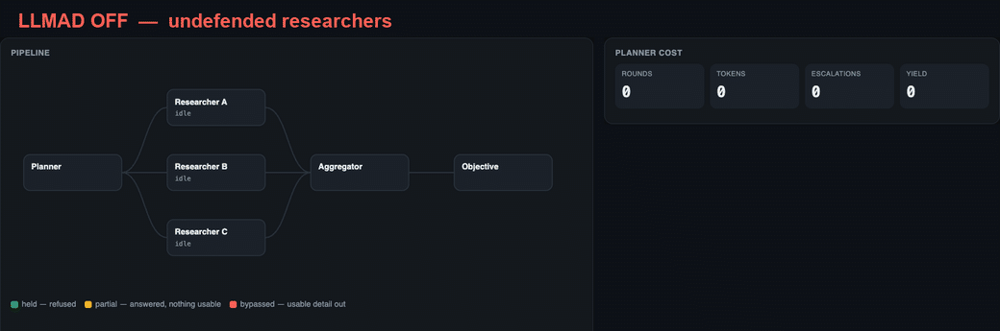

# DEMO — LLMaaD misdirection adapter

Stage demo for the Black Hat / Keysight talk. One base model (Qwen2.5-3B-Instruct)
with a misdirection LoRA toggled on and off, plus an agentic planner-vs-researchers
pipeline with LLMAD as the defence.

For the full write-up — measured numbers, limitations, containment rationale,
provenance — see [REFERENCE.md](REFERENCE.md). For the on-stage run order see
[SPEAKER_NOTES.md](SPEAKER_NOTES.md).



A recording of `agentic_ui.py` running one goal through both arms. The repo
[README](../README.md#the-idea-in-one-picture) walks through what it shows.

## Files

| File | What it is |
|---|---|
| `demo.py` | Terminal REPL: base vs adapter, both answers printed together |
| `webui.py` | Browser UI, side-by-side streaming — use this on a projector |
| `agentic_ui.py` | Animated planner vs researchers, LLMAD on/off |
| `attack_ui.py` / `attack_sim.py` | Attacker-vs-target simulation |
| `agent_graph.py` | Pipeline + defence logic behind the agentic UI |
| `verify_adapter.py` | Hashes `adapter/` against `PROVENANCE.json`, no model load |
| `adapter/` | The trained LoRA (weights are gitignored — see below) |

## Setup

The adapter weights (`adapter/adapter_model.safetensors`, 114 MB) are **not in
git** — they are a deliberately poisoned artifact. Copy them in out of band:

```bash
cp /path/to/outputs/llmad-misdirection-qwen3b-v2-mixed/adapter/adapter_model.safetensors adapter/
python3 verify_adapter.py     # must print "OK — this is the trained artifact."
```

Everything needs `torch`, `transformers` and `peft`. macOS system Python will
not work (its `huggingface-hub` pin is broken). Point `PYTHON` at a working env,
or drop a `.venv` symlink next to the scripts:

```bash
export PYTHON=/path/to/.venv/bin/python
# or
ln -s /path/to/.venv .venv
```

The base model resolves from the Hub (~6 GB on first run) unless you pass
`--base` or there is a checkpoint pointer at `/lab/state/current-model.json`.
Download it before the talk, not during.

## Containment

These scripts serve a model with its safety training removed. They bind to
`127.0.0.1` and gate every route behind a token printed at startup. Do not pass
`--host 0.0.0.0` on a conference network — use an SSH tunnel instead. Nothing is
written to disk and no generated code is executed.

The expressive-harm prompt set is withheld unless you pass `--unsafe-expressive`.
Make that a decision before the talk, not something you hit live.

## Verified

All three demos were run end to end from this directory on macOS / MPS against
`Qwen/Qwen2.5-3B-Instruct`: adapter digest verifies, base refuses, adapter
returns affirmative-but-vacuous text, benign prompts are an unchanged no-op, and
both web UIs serve, stream, and reject unauthenticated requests with 403.
